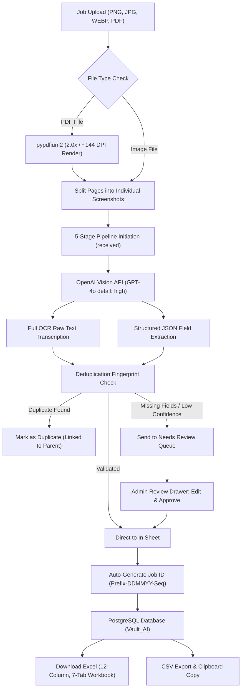

# JobVault AI — Screenshot to Excel Automated Processing System

[](https://www.python.org/)
[](https://www.djangoproject.com/)
[](https://www.django-rest-framework.org/)
[](https://www.postgresql.org/)
[](https://openai.com/)

**JobVault AI** is an end-to-end intelligent automation system that ingests job screenshots from messaging and social platforms (WhatsApp, LinkedIn, Telegram, Instagram), extracts characters and structured data using **OpenAI Vision API (GPT-4o / GPT-4o-mini)**, performs smart deduplication and confidence scoring, automatically assigns standard categorized **Job IDs**, and exports the data into client-standard **12-Column multi-tab Excel workbooks** and CSV sheets.

---

## Table of Contents
- [Key Features](#key-features)
- [System Architecture](#system-architecture)
- [Job ID Standard Format](#job-id-standard-format)
- [Client Master Excel Schema (12 Columns)](#client-master-excel-schema-12-columns)
- [Technology Stack](#technology-stack)
- [Directory Structure](#directory-structure)
- [Installation & Setup](#installation--setup)
- [Environment Configuration (.env)](#environment-configuration-env)
- [API Reference](#api-reference)
- [Verification & Testing](#verification--testing)

---

## Key Features

1. **Dual Ingestion (Screenshots & Multi-Page PDFs)**:
   - Ingests standalone screenshot images (`.png`, `.jpg`, `.jpeg`, `.webp`, `.heic`, `.bmp`).
   - Ingests single-page and multi-page PDF documents (`.pdf`).
   - Automatically renders each PDF page into high-resolution PNG images at 2.0x scale (~144 DPI) using `pypdfium2`, generating distinct screenshot records (`<Name> (Page N).png`) for independent OCR parsing, visual verification, and job extraction.

2. **High-Detail OpenAI Vision OCR**:
   - Transcribes all readable characters from screenshots word-for-word into `raw_text` using `detail: high` mode.
   - Extracts structured fields: Role, Sector, Company, Location, Country, Experience, Salary, Qualification, Other Details, and How to Apply.
   - Preserves exact character evidence strings linking extracted data back to the image.

3. **Automated 5-Stage Processing Pipeline**:
   - `received` ➔ `reading` ➔ `verifying` ➔ `sorting` ➔ `saved`.
   - Real-time progress indicators for every processed screenshot.

4. **Intelligent Deduplication**:
   - SHA-style text normalization and fingerprint hashing (`Title|Company|Contact`).
   - Configurable deduplication lookback window (default: 30 days).
   - Duplicate jobs are automatically flagged and linked to the existing record without polluting the master sheet.

5. **Review Queue & Interactive Drawer**:
   - Side-by-side modal view comparing the original screenshot with the extracted OCR text.
   - Real-time inline field editing.
   - Single-click **Approve & add to sheet** or **Reject** actions.

6. **Client-Standard Job ID Generation**:
   - Automatically prefixes IDs based on vault type (`C-`, `E-`, `L-`, `M-`, `R-`, `G-`).
   - Date-stamped with daily sequence numbers (e.g. `E-141026-49`, `C-141126-01`).

7. **Standardized 12-Column Excel & CSV Export**:
   - Generates Excel workbook with **All Jobs** master tab plus **6 dedicated Access Vault tabs**.
   - Identical 12 columns across every sheet with Navy Dark Header (`#15202C`), auto-width columns, and auto-filters.
   - In-app **Copy for Excel** feature copies the exact 12 columns formatted with tab delimiters for direct clipboard pasting.

8. **Direct Dashboard Access**:
   - Seamless unauthenticated access for internal enterprise dashboard usage at `http://127.0.0.1:8000/dashboard/`.

---

## System Architecture



---

## Job ID Standard Format

Every job in the system is assigned a standardized Job ID matching the client's specification:

$$\text{Format: } \mathbf{[Prefix]\text{-}[DDMMYY]\text{-}[NN]}$$

| Prefix | Access Vault Category | Target Audience | Example Job ID |
| :---: | :--- | :--- | :--- |
| **`C-`** | **Early Career Access Vault** | Freshers, Interns, 0–2 years exp | `C-141026-01` |
| **`E-`** | **Executive Access Vault** | C-Suite, VP, Director, CXO (15+ yrs) | `E-141026-49` |
| **`L-`** | **Leadership Access Vault** | Senior Leaders, Heads (10+ yrs) | `L-141026-01` |
| **`M-`** | **Management Access Vault** | Managers, Mid-level & Junior (3–9 yrs) | `M-141026-02` |
| **`R-`** | **Remote Access Vault** | Remote, Work-From-Home, Anywhere | `R-141026-01` |
| **`G-`** | **UAE & Global Access Vault** | UAE, Dubai, Gulf, International | `G-141026-50` |

---

## Client Master Excel Schema (12 Columns)

When downloading the Excel workbook (`/api/export.xlsx`), **all sheets** strictly adhere to this exact 12-column layout:

| Col # | Column Name | Source Field | Description | Alignment |
| :---: | :--- | :--- | :--- | :---: |
| **A** | **`S. No.`** | Sequence Counter | 1, 2, 3... per sheet | Center |
| **B** | **`Job ID`** | `job.job_id` | e.g. `E-141026-49` | Center |
| **C** | **`Date`** | Extracted / `created_at` | e.g. `14-10-2026` | Center |
| **D** | **`Role`** | `job.title` | Designation / Job Title | Left |
| **E** | **`Sector`** | `job.sector` | Industry / Domain | Left |
| **F** | **`Company`** | `job.company` | Company or Agency Name | Left |
| **G** | **`Salary`** | `job.salary` | Salary / Package / CTC | Left |
| **H** | **`Location`** | `job.location` | City / State / Onsite Location | Left |
| **I** | **`Experience`** | `job.experience` | Years of Experience required | Left |
| **J** | **`Qualification`**| `job.qualification` | Required Degree / Diploma | Left |
| **K** | **`Other Details`** | `job.other_details` | Job duties & requirements | Left |
| **L** | **`How to apply`** | `job.apply_contact` | Email, Phone, or URL | Left |

### Workbook Tab Structure:
1. `All Jobs` (Master overview of all jobs)
2. `Early Career Access Vault`
3. `Executive Access Vault`
4. `Leadership Access Vault`
5. `Management Access Vault`
6. `Remote Access Vault`
7. `UAE & Global Access Vault`

---

## Technology Stack

- **Backend**: Python 3.10+, Django 5.2, Django REST Framework 3.18
- **Authentication**: AllowAny for direct dashboard access, SimpleJWT available for token-based authentication
- **Database**: PostgreSQL (`Vault_AI`)
- **PDF & Document Processing**: `pypdfium2` (native high-resolution page rendering), `pypdf`
- **AI OCR & Vision**:
  - **OpenAI Vision API**: `gpt-4o-mini` / `gpt-4o` with `detail: high`
  - **Google Gemini API**: `gemini-2.5-flash` / `gemini-1.5-flash` (fallback)
- **Image Processing**: Pillow (PIL)
- **Excel Engine**: `openpyxl` with custom styling (PatternFill, Alignment, Borders)
- **Frontend**: Single-Page Application (HTML5, Vanilla JS, CSS Custom Properties)

---

## Directory Structure

```text
vault_ai_project/
├── requirements.txt
├── README.md
└── vault_ai/
    ├── manage.py
    ├── .env                         # Database and AI API configurations
    ├── requirements.txt
    ├── media/                       # Uploaded screenshots storage
    │   └── screenshots/
    ├── vault_ai/                    # Django project core
    │   ├── __init__.py
    │   ├── settings.py
    │   ├── urls.py
    │   └── wsgi.py
    └── myapp/                       # Main application
        ├── migrations/
        ├── models.py                # Screenshot, Job, AppSetting, ActivityLog
        ├── views.py                 # REST API Views, Excel/CSV exporters
        ├── serializers.py           # Model serializers
        ├── utils.py                 # Vision AI, OCR, Job ID generator, Dedupe
        ├── urls.py                  # API routing (pure path syntax)
        ├── tests.py                 # Automated unit tests
        └── templates/
            └── dashboard.html       # Web Dashboard SPA
```

---

## Installation & Setup

### 1. Prerequisites
- **Python 3.10+**
- **PostgreSQL 14+** running on `localhost:5432` with a database named `Vault_AI`.

### 2. Clone and Setup Environment

```powershell
# Navigate to the project root
cd "C:\Users\Dell Pc\Desktop\vault_ai_project\vault_ai"

# Create virtual environment (if not already created)
python -m venv venv

# Activate virtual environment
.\venv\Scripts\Activate.ps1

# Install required dependencies
pip install -r requirements.txt
```

### 3. Configure Database & Environment
Edit [`vault_ai/.env`](file:///c:/Users/Dell%20Pc/Desktop/vault_ai_project/vault_ai/.env):

```env
DEBUG=True
SECRET_KEY=django-insecure-your-secret-key-here

# PostgreSQL Database
DB_NAME=Vault_AI
DB_USER=postgres
DB_PASSWORD=your_password
DB_HOST=localhost
DB_PORT=5432

# AI OCR & Vision API Keys
OPENAI_API_KEY=sk-proj-your-openai-api-key-here
OPENAI_MODEL=gpt-4o-mini
GEMINI_API_KEY=
```

### 4. Run Migrations

```powershell
python manage.py makemigrations
python manage.py migrate
```

### 5. Start the Development Server

```powershell
python manage.py runserver 127.0.0.1:8000
```

Open your browser at:
- **Dashboard UI**: [http://127.0.0.1:8000/dashboard/](http://127.0.0.1:8000/dashboard/)
- **Root URL**: [http://127.0.0.1:8000/](http://127.0.0.1:8000/)

---

## Environment Configuration (.env)

| Variable | Default | Purpose |
| :--- | :--- | :--- |
| `DEBUG` | `True` | Django debug mode |
| `SECRET_KEY` | *(Django Secret)* | Cryptographic security signing |
| `DB_NAME` | `Vault_AI` | PostgreSQL database name |
| `DB_USER` | `postgres` | Database username |
| `DB_PASSWORD` | `rahul` | Database password |
| `DB_HOST` | `localhost` | Database host |
| `DB_PORT` | `5432` | Database port |
| `OPENAI_API_KEY` | *(Optional)* | Enables OpenAI GPT-4o Vision OCR character reading |
| `OPENAI_MODEL` | `gpt-4o-mini` | Specifies OpenAI model (`gpt-4o-mini` or `gpt-4o`) |
| `GEMINI_API_KEY` | *(Optional)* | Enables Google Gemini Vision OCR |

---

## API Reference

### 1. Screenshots APIs

#### `GET /api/screenshots`
Fetches the list of uploaded screenshots and current background queue counts.
- **Query Params**: `limit` (default: 60)
- **Response**:
```json
{
  "items": [
    {
      "id": 18,
      "filename": "screenshot_01.png",
      "original_name": "Job_Post.png",
      "size": 184500,
      "image": "http://127.0.0.1:8000/media/screenshots/screenshot_01.png",
      "origin": "upload",
      "source_app": "WhatsApp",
      "stage": "saved",
      "raw_text": "Customer Support Executive...",
      "job_count": 1,
      "created_at": "2026-11-14 11:44:05",
      "jobs": [
        {
          "id": 1142,
          "code": "C-141126-01",
          "status": "synced"
        }
      ]
    }
  ],
  "queue": {
    "queued": 0,
    "running": 0
  }
}
```

#### `POST /api/screenshots`
Uploads one or more screenshot images or PDF documents for instant Vision AI reading. If a PDF is uploaded, every page is rendered at 2.0x scale into an individual high-resolution screenshot and processed independently.
- **Content-Type**: `multipart/form-data`
- **Body**: `files`: Image files (`.png`, `.jpg`, `.jpeg`, `.webp`, `.heic`, `.bmp`) or PDF files (`.pdf`)
- **Response**: `201 Created`
```json
{
  "ids": [19, 20, 21]
}
```

#### `POST /api/screenshots/<id>/retry`
Re-runs OCR and parsing on a failed or review screenshot.
- **Response**: `{"ok": true}`

#### `DELETE /api/screenshots/<id>`
Deletes a screenshot and removes its non-synced draft jobs.
- **Response**: `{"ok": true}`

---

### 2. Jobs APIs

#### `GET /api/jobs`
List all extracted jobs with support for search and vault filtering.
- **Query Params**:
  - `status`: `all` | `synced` | `review` | `duplicate` | `rejected`
  - `vault`: `all` | `Early Career Access Vault` | `Executive Access Vault` | ...
  - `source`: `all` | `WhatsApp` | `LinkedIn` | `Telegram` | `Instagram`
  - `q`: Search keyword (matches title, company, location, salary, job_id)
- **Response**:
```json
{
  "items": [
    {
      "id": 1142,
      "code": "E-141026-49",
      "job_id": "E-141026-49",
      "title": "Head of Operations (National Head)",
      "sector": "NBFC / Bank Operations",
      "company": "Praxis TS (Aman)",
      "location": "Gurgaon (Hybrid)",
      "experience": "13-22 yrs",
      "salary": "Competitive National Head Scale",
      "qualification": "Bachelor's Degree / MBA",
      "other_details": "13-22 Years Experience in NBFC...",
      "work_mode": "Hybrid",
      "apply_contact": "aman@praxists.co.in",
      "vault": "India · Senior",
      "confidence": 0.99,
      "status": "synced"
    }
  ]
}
```

#### `GET /api/jobs/<id>`
Fetch complete details, image link, raw OCR transcription, and field evidence for a specific job.

#### `PUT /api/jobs/<id>`
Edit job fields (Title, Sector, Company, Location, Salary, Experience, Qualification, Other Details, Work Mode, Contact).

#### `POST /api/jobs/<id>/approve`
Approve a pending job from the Review Queue and promote it to `synced` (In Sheet).
- Automatically assigns a formatted `Job ID` if missing.
- **Response**: Returns updated Job object.

#### `POST /api/jobs/<id>/reject`
Marks a job as `rejected`.
- **Response**: Returns updated Job object.

---

### 3. Export APIs

#### `GET /api/export.xlsx`
Downloads the complete **Client-Standard 12-Column Excel Workbook** (`Website_Load_Export.xlsx`).
- Contains `All Jobs` tab + 6 individual Access Vault tabs.
- Custom Navy Blue `#15202C` header styling with auto-width columns.

#### `GET /api/export.csv`
Downloads the filtered or complete dataset in standard 12-column CSV format (`Website_Load_Export.csv`).

---

### 4. System & Integration APIs

- `GET /api/stats`: Real-time KPI counts (Total screenshots, In Sheet jobs, Review queue, Vault breakdown).
- `GET /api/activity`: Activity audit trail logs.
- `GET /api/integrations`: Active AI vision provider status (`openai`, `gemini`, `mock`).
- `PUT /api/settings/ai`: Update AI threshold, strict validation, and deduplication settings.
- `PUT /api/settings/rules`: Update vault tier sorting rules and experience cutoffs.

---

## Verification & Testing

To run the complete automated test suite:

```powershell
cd "C:\Users\Dell Pc\Desktop\vault_ai_project\vault_ai"
.\venv\Scripts\python.exe manage.py test myapp
```

Expected result:
```text
Creating test database for alias 'default'...
........
----------------------------------------------------------------------
Ran 8 tests in 2.280s

OK
Destroying test database for alias 'default'...
```

---

## License & Authors
- **Developed by**: Dr. Design / Engineering Team
- **Project**: JobVault AI Automation System
- **All rights reserved**.
