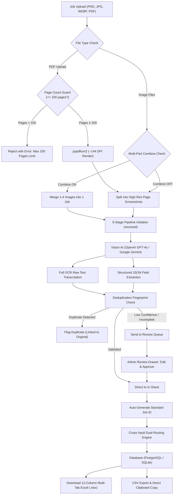

# JobVault AI — Screenshot & PDF to Excel Automated Processing System

[](https://www.python.org/)
[](https://www.djangoproject.com/)
[](https://www.django-rest-framework.org/)
[](https://www.postgresql.org/)
[](https://openai.com/)
[](https://whitenoise.readthedocs.io/)
[](https://gunicorn.org/)
[](#verification--testing)

**JobVault AI** is an enterprise-grade intelligent automation platform that ingests job screenshots and multi-page PDF documents from messaging and social channels (WhatsApp, LinkedIn, Telegram, Instagram), extracts full OCR characters and structured job attributes using **OpenAI Vision API (GPT-4o / GPT-4o-mini)** and **Google Gemini Vision**, performs smart deduplication and confidence scoring, automatically generates standard categorized **Job IDs**, dual-routes jobs across multiple access vaults, and exports the data into client-standard **12-Column multi-tab Excel workbooks** and CSV sheets.

---

## Table of Contents
- [Key Features](#key-features)
- [System Architecture](#system-architecture)
- [Job ID Standard Format & Vault Rules](#job-id-standard-format--vault-rules)
- [Cross-Vault Dual-Routing Architecture](#cross-vault-dual-routing-architecture)
- [Dynamic Vaults Management (Admin Customization)](#dynamic-vaults-management-admin-customization)
- [PDF Page Limit & Ingestion Guardrails](#pdf-page-limit--ingestion-guardrails)
- [Client Master Excel Schema (12 Columns)](#client-master-excel-schema-12-columns)
- [Technology Stack](#technology-stack)
- [Directory Structure](#directory-structure)
- [Installation & Local Setup](#installation--local-setup)
- [Environment Configuration (.env)](#environment-configuration-env)
- [Production Deployment Guide](#production-deployment-guide)
- [API Reference](#api-reference)
  - [1. Screenshots APIs](#1-screenshots-apis)
  - [2. Jobs APIs](#2-jobs-apis)
  - [3. Vaults Management APIs](#3-vaults-management-apis)
  - [4. Export APIs](#4-export-apis)
  - [5. Authentication & Security Suite](#5-authentication--security-suite)
  - [6. System & Integration APIs](#6-system--integration-apis)
- [Verification & Testing](#verification--testing)
- [License & Authors](#license--authors)

---

## Key Features

1. **Dual Ingestion (Screenshots & Multi-Page PDFs)**:
   - Ingests standalone screenshot images (`.png`, `.jpg`, `.jpeg`, `.webp`, `.heic`, `.bmp`).
   - Ingests single-page and multi-page PDF documents (`.pdf`).
   - Automatically renders each PDF page into high-resolution PNG images at 2.0x scale (~144 DPI) using `pypdfium2`, generating distinct screenshot records (`<Name> (Page N).png`) for independent OCR parsing, visual verification, and job extraction.

2. **PDF Page Upload Guardrail (1–100 Pages Limit)**:
   - Protects server memory, AI token quotas, and async worker pipelines by enforcing a maximum of **100 pages per PDF**.
   - If a document exceeds 100 pages, upload processing is safely halted and a clear, readable error banner is returned immediately:
     ```
     "PDF contains X pages, which exceeds the maximum limit of 100 pages. Please upload a PDF with 1-100 pages."
     ```

3. **Multi-Part Screenshot Combination (`Combine into 1 single job`)**:
   - Checkbox-enabled batch upload that allows combining 1–4 screenshot parts of a single elongated/scrolled job posting into one consolidated job listing.
   - Stitches multi-part OCR transcriptions, aggregates field information, and generates a single clean database entry.

4. **Dynamic Vaults Management (Admin CRUD)**:
   - Full in-app management of access vaults directly from the Web Dashboard.
   - Admins can add new custom vaults, edit existing vault titles, modify minimum/maximum experience requirements, update descriptions, and toggle active status.
   - Instant visual update with dedicated `✏️ Edit` button on each vault card and `+ Add Vault` header button.

5. **High-Detail OpenAI Vision & Gemini OCR**:
   - Transcribes all readable characters from screenshots word-for-word into `raw_text` using `detail: high` mode.
   - Extracts structured fields: Role, Sector, Company, Location, Country, Experience, Salary, Qualification, Other Details, and How to Apply.
   - Preserves exact character evidence strings linking extracted data back to the image.

6. **Automated 5-Stage Processing Pipeline**:
   - `received` ➔ `reading` ➔ `verifying` ➔ `sorting` ➔ `saved`.
   - Real-time progress indicators for every processed screenshot.

7. **Cross-Vault Dual-Routing Engine**:
   - Intelligent multi-vault classification where jobs are automatically assigned to multiple relevant vaults simultaneously.
   - E.g., a Remote listing with 1-2 years experience is routed to both **`Remote`** AND **`India · Fresher`** vaults, ensuring complete visibility across both work-mode and experience-based recruiter pipelines.

8. **Intelligent Deduplication**:
   - SHA-style text normalization and fingerprint hashing (`Title|Company|Contact`).
   - Configurable deduplication lookback window (default: 30 days).
   - Duplicate jobs are automatically flagged and linked to the existing record without polluting the master sheet.

9. **Review Queue & Interactive Drawer**:
   - Side-by-side modal view comparing the original screenshot with the extracted OCR text.
   - Real-time inline field editing.
   - Single-click **Approve & add to sheet** or **Reject** actions.

10. **Client-Standard Job ID Generation**:
    - Automatically prefixes IDs based on vault type (`C-`, `M-`, `L-`, `E-`, `R-`, `G-`).
    - Date-stamped with daily sequence numbers (e.g. `E-141026-49`, `C-141126-01`, `R-191126-01`).

11. **Standardized 12-Column Excel & CSV Export**:
    - Generates Excel workbook with **All Jobs** master tab plus **dedicated Access Vault tabs**.
    - Identical 12 columns across every sheet with Navy Dark Header (`#15202C`), auto-width columns, and auto-filters.
    - In-app **Copy for Excel** feature copies the exact 12 columns formatted with tab delimiters for direct clipboard pasting.

12. **AI Social Media Content Generator (LinkedIn & Instagram)**:
    - Automatically generates high-converting, platform-optimized social media posts from screenshot OCR and job attributes.
    - **LinkedIn**: Professional format with engaging hook, company overview, role bullets, application link, and industry hashtags.
    - **Instagram**: Catchy caption with clean layout, emojis, quick-read summary, CTA, and 8-12 trending career hashtags.
    - 1-click copy buttons directly from the Job Drawer modal.

13. **Modern SPA UI & Clean URL Routing**:
    - Clean routing using HTML5 History API (`history.pushState` / `history.replaceState`) without hash fragments (`/dashboard/`).
    - Full-width responsive layout for high-resolution displays.
    - Dual Theme (Light Mode & Dark Mode) with instant 1-click toggle (`☀️` / `🌙`) and `localStorage` persistence.

14. **Production Deployment Ready**:
    - Cross-platform dependency specification in `requirements.txt` (`gunicorn` on Linux; Windows OCR dependencies isolated).
    - `WhiteNoise` static file handling integrated into Django middleware.
    - Flexible database adapter supporting `DATABASE_URL` (cloud providers), PostgreSQL, and SQLite fallback.
    - `Procfile` included for container and cloud deployments.

---

## System Architecture



---

## Job ID Standard Format & Vault Rules

Every job in the system is assigned a standardized Job ID matching the client specification:

$$\text{Format: } \mathbf{[Prefix]\text{-}[DDMMYY]\text{-}[NN]}$$

| Prefix | Access Vault Category | Target Audience & Experience Tier | Example Job ID |
| :---: | :--- | :--- | :--- |
| **`C-`** | **Early Career Access Vault** | Freshers, Interns, 0–2 years exp | `C-241126-01` |
| **`M-`** | **Management Access Vault** | Junior & Mid-level Managers (2–10 yrs) | `M-241126-02` |
| **`L-`** | **Leadership Access Vault** | Senior Leaders, Heads, Team Leads (10+ yrs) | `L-241126-01` |
| **`E-`** | **Executive Access Vault** | C-Suite, VP, Director, CXO (15+ yrs) | `E-241126-49` |
| **`R-`** | **Remote Access Vault** | Remote, Work-From-Home, Anywhere | `R-241126-01` |
| **`G-`** | **UAE & Global Access Vault** | Outside India, Gulf, International | `G-241126-01` |

---

## Cross-Vault Dual-Routing Architecture

In recruitment workflows, candidates search both by **work style** (e.g. Remote) and by **seniority level** (e.g. 0-2 yrs Fresher, 2-5 yrs Junior). JobVault AI implements an automated **Dual-Routing Matrix**:

```
                         ┌──► Vault 1: "Remote" (Work Mode Filter)
[Remote Job Extracted] ──┤
                         └──► Vault 2: "India · Fresher" or "India · Junior" (Experience Filter)
```

- When a job is marked as `Remote`, it is routed to the `Remote` vault **AND** placed into the matching experience tier (`India · Fresher`, `India · Junior`, etc.).
- Both vault tags appear in the Job Sheet table and are appropriately mirrored across the corresponding tabs in the downloaded Excel workbook.

---

## Dynamic Vaults Management (Admin Customization)

Admins have full control over the vault hierarchy directly from the UI or via REST endpoints:

- **Add Custom Vault**: Create new specialized categories (e.g. `Healthcare Tech`, `Data & AI`, `Internships`).
- **Edit Existing Vault**: Modify the vault name, description, experience bounds (min/max years), and display priority.
- **Delete Vault**: Remove vaults that are no longer needed.
- **REST APIs**: Full CRUD support via `/api/vaults/` and `/api/vaults/<vault_name>/`.

---

## PDF Page Limit & Ingestion Guardrails

To maintain high availability and prevent processing delays:
- **Maximum Limit**: **100 pages per PDF**.
- **Enforcement**: Validated before rasterization and OCR processing.
- **User Feedback**: Immediate HTTP 400 error with descriptive messaging:
  ```json
  {
    "error": "PDF contains 125 pages, which exceeds the maximum limit of 100 pages. Please upload a PDF with 1-100 pages."
  }
  ```

---

## Client Master Excel Schema (12 Columns)

When downloading the Excel workbook (`/api/export.xlsx`), **all sheets** strictly adhere to this exact 12-column layout:

| Col # | Column Name | Source Field | Description | Alignment |
| :---: | :--- | :--- | :--- | :---: |
| **A** | **`S. No.`** | Sequence Counter | 1, 2, 3... per sheet | Center |
| **B** | **`Job ID`** | `job.job_id` | e.g. `R-241126-01` | Center |
| **C** | **`Date`** | Extracted / `created_at` | e.g. `24-11-2026` | Center |
| **D** | **`Role`** | `job.title` | Designation / Job Title | Left |
| **E** | **`Sector`** | `job.sector` | Industry / Domain | Left |
| **F** | **`Company`** | `job.company` | Company or Agency Name | Left |
| **G** | **`Salary`** | `job.salary` | Salary / Package / CTC | Left |
| **H** | **`Location`** | `job.location` | City / State / Onsite Location | Left |
| **I** | **`Experience`** | `job.experience` | Years of Experience required | Left |
| **J** | **`Qualification`**| `job.qualification` | Required Degree / Diploma | Left |
| **K** | **`Other Details`** | `job.other_details` | Job duties & requirements | Left |
| **L** | **`How to apply`** | `job.apply_contact` | Email, Phone, or URL | Left |

### Workbook Tab Structure:
1. `All Jobs` (Master overview of all jobs)
2. `India · Fresher` / `Early Career Access Vault`
3. `India · Junior`
4. `India · Mid-level` / `Management Access Vault`
5. `India · Senior` / `Leadership & Executive Access Vault`
6. `Remote` / `Remote Access Vault`
7. `Global` / `UAE & Global Access Vault`
8. *(Dynamic custom vault tabs automatically generated)*

---

## Technology Stack

- **Backend Framework**: Python 3.10+, Django 5.2, Django REST Framework 3.18
- **WSGI Production Server**: Gunicorn 21.2+ (Linux/Cloud)
- **Static Asset Serving**: WhiteNoise 6.12+ (compressed, auto-manifest)
- **Database Engine**: PostgreSQL 14+ (production) / SQLite3 (development)
- **Authentication**: JWT (`rest_framework_simplejwt`) + Session/AllowAny for internal dashboard
- **PDF & Rendering Engine**: `pypdfium2` (native ~144 DPI C-bindings rendering), `pypdf`
- **AI OCR & Vision Extraction**:
  - **OpenAI Vision API**: `gpt-4o-mini` / `gpt-4o` with `detail: high`
  - **Google Gemini API**: `gemini-2.5-flash` / `gemini-1.5-flash`
- **Image Processing**: Pillow (PIL) 12.3+
- **Excel & Spreadsheet Engine**: `openpyxl` 3.1+ (Navy Dark styling `#15202C`, auto-filters, text wrapping)
- **Frontend SPA**: Vanilla JavaScript, HTML5 History API, CSS Custom Properties (Dual Light & Dark Theme)

---

## Directory Structure

```text
vault_ai_project/
├── requirements.txt                 # Root production dependency definitions
├── README.md                        # Project documentation
└── vault_ai/
    ├── manage.py                    # Django management utility
    ├── .env                         # Production environment secrets & config
    ├── Procfile                     # Cloud WSGI process declaration (Gunicorn)
    ├── requirements.txt             # Deployment requirements with platform markers
    ├── staticfiles/                 # Static assets directory (WhiteNoise / collectstatic)
    ├── media/                       # Uploaded screenshots and rendered PDF pages
    │   └── screenshots/
    ├── vault_ai/                    # Django project core
    │   ├── __init__.py
    │   ├── settings.py              # Environment-aware settings, WhiteNoise, DB router
    │   ├── urls.py                  # Project root URL routing
    │   └── wsgi.py                  # WSGI entrypoint for Gunicorn
    └── myapp/                       # Primary application module
        ├── migrations/              # Database schema migrations
        ├── models.py                # Screenshot, Job, AppSetting, ActivityLog, CustomUser
        ├── views.py                 # REST APIs, Vault CRUD, Exporters, Auth views
        ├── serializers.py           # Model & validation serializers
        ├── utils.py                 # AI Vision OCR, Deduplication, Job ID generator
        ├── urls.py                  # API endpoints definition
        ├── tests.py                 # Unit & integration test suite (11 test cases)
        └── templates/
            └── dashboard.html       # Single-Page Web Dashboard (SPA)
```

---

## Installation & Local Setup

### 1. Prerequisites
- **Python 3.10 or higher**
- **Git**
- **PostgreSQL 14+** (Optional: defaults automatically to SQLite if PostgreSQL is not active)

### 2. Clone and Setup Virtual Environment

```powershell
# Navigate to the project directory
cd "C:\Users\Dell Pc\Desktop\vault_ai_project\vault_ai"

# Create a virtual environment
python -m venv venv

# Activate the virtual environment
# Windows PowerShell:
.\venv\Scripts\Activate.ps1
# Linux / macOS:
# source venv/bin/activate

# Upgrade pip and install dependencies
pip install --upgrade pip
pip install -r requirements.txt
```

### 3. Configure Environment Variables
Create or verify `.env` inside `vault_ai/`:

```env
DEBUG=True
SECRET_KEY=django-insecure-your-secret-key-here
ALLOWED_HOSTS=*

# Database (Leave USE_POSTGRES=False to use SQLite out-of-the-box)
USE_POSTGRES=False
DB_NAME=Vault_AI
DB_USER=postgres
DB_PASSWORD=your_password
DB_HOST=localhost
DB_PORT=5432

# AI OCR & Vision API Keys
OPENAI_API_KEY=sk-proj-your-openai-api-key-here
OPENAI_MODEL=gpt-4o-mini
GEMINI_API_KEY=your-gemini-key-if-using
```

### 4. Run Migrations & Collect Static Files

```powershell
python manage.py makemigrations
python manage.py migrate
python manage.py collectstatic --noinput
```

### 5. Launch the Development Server

```powershell
python manage.py runserver 127.0.0.1:8000
```

Access the application in your browser:
- **Dashboard UI**: [http://127.0.0.1:8000/dashboard/](http://127.0.0.1:8000/dashboard/)
- **API Root**: [http://127.0.0.1:8000/api/](http://127.0.0.1:8000/api/)
- **Django Admin**: [http://127.0.0.1:8000/admin/](http://127.0.0.1:8000/admin/)

---

## Environment Configuration (.env)

| Variable | Default | Purpose |
| :--- | :--- | :--- |
| `DEBUG` | `True` | Set to `False` in production |
| `SECRET_KEY` | *(Django Secret)* | Cryptographic security signing |
| `ALLOWED_HOSTS` | `*` | Comma-separated domain names / IPs |
| `CSRF_TRUSTED_ORIGINS` | *(Empty)* | Comma-separated full HTTPS URLs for CORS/CSRF |
| `DATABASE_URL` | *(None)* | Cloud PostgreSQL connection string (Render, Railway, Heroku) |
| `USE_POSTGRES` | `False` | `True` to enable dedicated PostgreSQL connection |
| `DB_NAME` | `Vault_AI` | PostgreSQL database name |
| `DB_USER` | `postgres` | Database username |
| `DB_PASSWORD` | `rahul` | Database password |
| `DB_HOST` | `localhost` | Database host |
| `DB_PORT` | `5432` | Database port |
| `OPENAI_API_KEY` | *(Optional)* | Enables OpenAI GPT-4o Vision OCR character reading |
| `OPENAI_MODEL` | `gpt-4o-mini` | Specifies OpenAI model (`gpt-4o-mini` or `gpt-4o`) |
| `GEMINI_API_KEY` | *(Optional)* | Enables Google Gemini Vision OCR |
| `EMAIL_HOST` | `smtp.gmail.com` | SMTP Server for password reset OTP |
| `EMAIL_HOST_USER` | *(Email)* | Sender email address |
| `EMAIL_HOST_PASSWORD` | *(App Password)* | Sender SMTP App Password |

---

## Production Deployment Guide

### Deploying to Linux VPS / Ubuntu / Debian

1. **System Packages**:
   ```bash
   sudo apt update && sudo apt install -y python3-pip python3-venv git postgresql nginx
   ```

2. **Clone & Install**:
   ```bash
   git clone <repo-url> /var/www/vault_ai
   cd /var/www/vault_ai/vault_ai
   python3 -m venv venv
   source venv/bin/activate
   pip install --upgrade pip
   pip install -r requirements.txt
   ```
   *(Note: Platform markers automatically skip `winocr` and Windows runtime packages on Linux).*

3. **Configure Environment**:
   ```bash
   cp .env.example .env
   nano .env
   # Set DEBUG=False, ALLOWED_HOSTS=yourdomain.com, and DB credentials
   ```

4. **Prepare Assets & Database**:
   ```bash
   python manage.py migrate
   python manage.py collectstatic --noinput
   ```

5. **Run with Gunicorn**:
   ```bash
   gunicorn --workers 3 --bind 127.0.0.1:8000 vault_ai.wsgi:application
   ```

6. **Systemd Service Setup (`/etc/systemd/system/vault_ai.service`)**:
   ```ini
   [Unit]
   Description=JobVault AI Gunicorn Service
   After=network.target

   [Service]
   User=www-data
   Group=www-data
   WorkingDirectory=/var/www/vault_ai/vault_ai
   ExecStart=/var/www/vault_ai/vault_ai/venv/bin/gunicorn --workers 3 --bind 127.0.0.1:8000 vault_ai.wsgi:application

   [Install]
   WantedBy=multi-user.target
   ```

### Deploying to Render / Railway / PaaS

1. **Build Command**:
   ```bash
   pip install -r requirements.txt && python manage.py migrate && python manage.py collectstatic --noinput
   ```
2. **Start Command**:
   ```bash
   gunicorn vault_ai.wsgi:application
   ```
3. **Environment Variables**:
   - `DATABASE_URL`: Automatically populated by cloud managed PostgreSQL.
   - `DEBUG`: `False`
   - `SECRET_KEY`: High-entropy random key.
   - `ALLOWED_HOSTS`: `.onrender.com` or your custom domain.

---

## API Reference

### 1. Screenshots APIs

#### `GET /api/screenshots`
Fetches uploaded screenshots with pagination and status queues.
- **Query Params**: `limit` (default: 60)
- **Response**:
```json
{
  "items": [
    {
      "id": 18,
      "filename": "screenshot_01.png",
      "original_name": "Job_Post.png",
      "size": 184500,
      "image": "/media/screenshots/screenshot_01.png",
      "origin": "upload",
      "source_app": "WhatsApp",
      "stage": "saved",
      "raw_text": "Customer Support Executive...",
      "job_count": 1,
      "created_at": "2026-11-24 10:15:00",
      "jobs": [
        {
          "id": 1142,
          "code": "C-241126-01",
          "status": "synced"
        }
      ]
    }
  ],
  "queue": {
    "queued": 0,
    "running": 0
  }
}
```

#### `POST /api/screenshots`
Uploads screenshots or PDFs for Vision AI extraction.
- **Query Params**: `combine=true` (merges uploaded parts into 1 single job).
- **Body (`multipart/form-data`)**: `files` (Images or PDF documents).
- **Safety Rule**: PDFs with > 100 pages return HTTP 400 with a descriptive error.
- **Response**: `201 Created`
```json
{
  "ids": [19, 20, 21]
}
```

#### `POST /api/screenshots/<id>/retry`
Re-runs OCR and parsing on a screenshot.
- **Response**: `{"ok": true}`

#### `DELETE /api/screenshots/<id>`
Deletes a screenshot and its associated unsynced draft jobs.
- **Response**: `{"ok": true}`

---

### 2. Jobs APIs

#### `GET /api/jobs`
List all extracted jobs with multi-facet filtering.
- **Query Params**:
  - `status`: `all` | `synced` | `review` | `duplicate` | `rejected`
  - `vault`: `all` | `India · Fresher` | `Remote` | `Global` | ...
  - `source`: `all` | `WhatsApp` | `LinkedIn` | `Telegram` | `Instagram`
  - `q`: Search keyword (matches title, company, location, salary, job_id)

#### `GET /api/jobs/<id>`
Retrieves full job attributes, raw OCR transcription, and extraction confidence.

#### `PUT /api/jobs/<id>`
Update job attributes (title, sector, company, location, salary, experience, qualification, other details, contact, work mode).

#### `POST /api/jobs/<id>/approve`
Promotes a pending review job to `synced` (In Sheet) and assigns a formatted `Job ID`.

#### `POST /api/jobs/<id>/reject`
Marks a job as `rejected`.

#### `POST /api/jobs/<id>/generate-content`
Generates platform-ready social media posts for LinkedIn and Instagram.
- **Response**:
```json
{
  "ok": true,
  "job_id": "R-241126-01",
  "title": "Junior Talent Acquisition Specialist",
  "company": "LevelupForWomen",
  "content": {
    "linkedin": "🌟 We are Hiring! | Junior Talent Acquisition Specialist at LevelupForWomen 🚀...",
    "instagram": "💼✨ NEW JOB ALERT: Junior Talent Acquisition Specialist!...",
    "summary": "Junior Talent Acquisition Specialist at LevelupForWomen (Remote)",
    "hashtags": ["#TalentAcquisition", "#RemoteJobs", "#HiringNow", "#Recruitment"]
  }
}
```

---

### 3. Vaults Management APIs

#### `GET /api/vaults/`
Returns all access vaults, their configured experience ranges, and current active job counts.
- **Response**:
```json
[
  {
    "name": "India · Fresher",
    "description": "India: 0-2 yrs (Freshers & 1-2 yrs)",
    "min_exp": 0,
    "max_exp": 2,
    "job_count": 8,
    "is_active": true
  },
  {
    "name": "Remote",
    "description": "Remote / work from anywhere",
    "min_exp": 0,
    "max_exp": 99,
    "job_count": 5,
    "is_active": true
  }
]
```

#### `POST /api/vaults/`
Create a new custom access vault.
- **Payload**:
```json
{
  "name": "Data Science & AI",
  "description": "Machine Learning, LLM, and Data Engineering roles",
  "min_exp": 1,
  "max_exp": 5
}
```

#### `PUT /api/vaults/<name>/`
Edit an existing vault's details or rename it.
- **Payload**:
```json
{
  "name": "India · Fresher & Intern",
  "description": "India: 0-1 yrs (Freshers, Interns & Graduates)",
  "min_exp": 0,
  "max_exp": 1
}
```

#### `DELETE /api/vaults/<name>/`
Deletes a custom vault.

---

### 4. Export APIs

#### `GET /api/export.xlsx`
Downloads the complete **Client-Standard 12-Column Excel Workbook** (`Website_Load_Export.xlsx`).
- Contains `All Jobs` tab + individual Access Vault tabs.
- Custom Navy Dark `#15202C` header styling with auto-width columns.

#### `GET /api/export.csv`
Downloads the filtered or complete dataset in standard 12-column CSV format (`Website_Load_Export.csv`).

---

### 5. Authentication & Security Suite

| Method | Endpoint | Description |
| :--- | :--- | :--- |
| `POST` | `/api/auth/login` | Authenticates user with username/email and password, returns JWT Access & Refresh tokens. |
| `POST` | `/api/auth/signup` / `/api/auth/register` | Registers new administrator account. |
| `POST` | `/api/auth/token/refresh` | Refreshes expired JWT Access Token. |
| `GET` / `PUT` | `/api/auth/me` | Retrieves or updates the currently logged-in user profile. |
| `POST` | `/api/auth/change-password` | Authenticated user changes password (requires `old_password` and `new_password`). |
| `POST` | `/api/auth/forgot-password` | Initiates password reset by email. Generates secure reset token & 6-digit OTP (15 min expiry). |
| `POST` | `/api/auth/verify-reset-token` | Verifies whether the supplied OTP or reset token is valid before setting a new password. |
| `POST` | `/api/auth/reset-password` | Confirms and updates the user's password using the validated token or OTP. |
| `POST` | `/api/auth/logout` | Logs out the user and invalidates/blacklists the refresh token. |

---

### 6. System & Integration APIs

- `GET /api/stats`: Real-time KPI counts (Total screenshots, In Sheet jobs, Review queue, Vault breakdown).
- `GET /api/activity`: Activity audit trail logs.
- `GET /api/integrations`: Active AI vision provider status (`openai`, `gemini`, `mock`).
- `PUT /api/settings/ai`: Update AI threshold, strict validation, and deduplication settings.
- `PUT /api/settings/rules`: Update vault tier sorting rules and experience cutoffs.

---

## Verification & Testing

To execute the automated unit and integration test suite:

```powershell
cd "C:\Users\Dell Pc\Desktop\vault_ai_project\vault_ai"
.\venv\Scripts\python.exe manage.py test myapp
```

Output:
```text
Creating test database for alias 'default'...
Found 11 test(s).
System check identified no issues (0 silenced).
...........
----------------------------------------------------------------------
Ran 11 tests in 13.049s

OK
Destroying test database for alias 'default'...
```

---

## License & Authors
- **Developed by**: Dr. Design / Engineering Team
- **Project**: JobVault AI Automation System
- **All rights reserved**.
